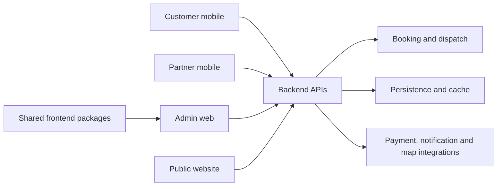

# Lexho Workspace - Interview Preparation Guide

Prepared: 9 October 2026. Language: Hinglish, with interview-ready English answers.

Yeh guide current workspace ke source code, package manifests, route registries aur existing documentation par based hai. Isme 4 frontend apps, 6 shared packages aur workspace mein present Java backend ke Maven/business modules cover hain. `Downloads/lexho-user-service-master` wali open IDE file is workspace ka part nahi hai; us external project ko inspect nahi kiya gaya.

**Status ka meaning:** code/screen/service present hona production deployment ya successful end-to-end execution ka proof nahi hai. Is documentation task mein apps build/run, payment, GPS, push ya backend integration tests execute nahi kiye gaye. Apni actual contribution aur verified results hi interview mein claim karein.

## Contents

1. [Project introduction](#1-project-introduction)
2. [Workspace and architecture](#2-workspace-and-architecture)
3. [Admin web modules](#3-admin-web-modules)
4. [Customer mobile modules](#4-customer-mobile-modules)
5. [Partner mobile modules](#5-partner-mobile-modules)
6. [Public website](#6-public-website)
7. [Shared packages](#7-shared-packages)
8. [Backend projects and modules](#8-backend-projects-and-modules)
9. [End-to-end flows](#9-end-to-end-flows)
10. [Technical interview questions](#10-technical-interview-questions)
11. [Challenges and contribution answers](#11-challenges-and-contribution-answers)
12. [Commands and study plan](#12-commands-and-study-plan)
13. [Source references and limitations](#13-source-references-and-limitations)

## 1. Project introduction

Lexho ek home-services marketplace platform hai. Customer service discover/book karta hai, partner availability aur assigned jobs manage karta hai, aur admin catalog, dispatch, payments aur support operations control karta hai. Public website services, cities, policies aur support information expose karti hai.

### 30-second English introduction

> Lexho is a home-services marketplace with an admin web application, customer and partner mobile applications, and a public website. The workspace also contains reusable frontend packages and a Java Spring Boot backend source tree. Its main workflows include service discovery, booking, partner assignment, job tracking, payments, subscriptions, notifications, and support.

### 2-minute explanation structure

1. **Problem:** customer ko services book karna aur operations team ko professionals coordinate karna hota hai.
2. **Actors:** customer, partner, admin aur public visitor.
3. **Frontend:** React web apps aur React Native mobile apps, TypeScript ke saath.
4. **Core journey:** discovery -> booking -> payment/status -> assignment -> tracking -> execution -> review/support. Exact sequence booking mode aur backend contract par depend karti hai.
5. **Architecture:** frontend monorepo; backend source mein single-application multi-module Spring Boot build.
6. **Your work:** sirf apne implemented modules, decisions aur tested edge cases explain karein.

## 2. Workspace and architecture

```text
lexho-frontend-monorepo/
  apps/
    admin/                    React admin web
    website/                  React public website
    customer/legacy-mobile/   React Native customer app
    partner/legacy-mobile/    React Native partner app
  packages/
    api/ auth/ constants/ hooks/ ui/ utils/
  output/
    subscription-backend/     Maven multi-module Java backend source
    ...                       Diagnostic/verification scripts
  scripts/                    Android launch and maintenance scripts
```

| Project | Location | Main responsibility | Declared stack |
| --- | --- | --- | --- |
| Admin web | `apps/admin` | Marketplace management and operations | React 19, TypeScript, Vite 8, Router 7, React Query 5, Axios, Zustand |
| Customer mobile | `apps/customer/legacy-mobile` | Discovery, booking and customer experience | React Native 0.85.0, React 19, Redux Toolkit, React Query, React Navigation |
| Partner mobile | `apps/partner/legacy-mobile` | Availability, dispatch and job execution | React Native 0.85.2, React 19, Redux Toolkit, redux-persist, React Query |
| Public website | `apps/website` | Public catalog, service cities, policies and support | React 19, TypeScript, Vite 8, Router 7, Fetch |
| Backend source | `output/subscription-backend` | APIs and business orchestration | Java 17, Spring Boot 3.5.11, Maven, JPA, MySQL, Redis, Flyway |

Versions yahan package/POM declarations hain, installed dependency ya latest public release claims nahi.



Root workspaces `apps/*` aur `packages/*` hain. Mobile manifests nested `legacy-mobile` mein hain; root scripts unhe `--prefix` ya PowerShell helper se launch karte hain. Sab apps ko automatically same shared architecture use karne wala na batayein: admin shared dependencies declare karta hai, mobile mein app-specific API/state implementations hain.

## 3. Admin web modules

Main references: [App.tsx](apps/admin/src/App.tsx), [route registry](apps/admin/src/navigation/adminRoutes.tsx), [API client](apps/admin/src/api/axios.ts).

Admin mein feature-first structure hai: domain ke pages/components aur route metadata `src/features` ke andar rakhe gaye hain. Main route registry feature exports compose karti hai. Forms ke liye React Hook Form/Zod, tables ke liye TanStack Table, charts ke liye Recharts, maps ke liye Mapbox aur notifications ke liye Firebase/STOMP dependencies present hain.

| Folder/module | Business responsibility | Interview focus |
| --- | --- | --- |
| `auth` | Login, OTP and admin session | Route guards, session restore, token expiry |
| `dashboard` | Operations overview and summary displays | Server data vs derived UI data |
| `users` | Customer listing, detail and management | Pagination, filters, validation |
| `bookings` | Booking list/detail/edit and operations | Lifecycle consistency and cache invalidation |
| `partners` | Partner feature exports | Check actual route ownership before claiming standalone page |
| `providers` | Provider feature exports | Provider vs partner terminology; folder presence != independent workflow |
| `partner-onboarding` | Partner onboarding administration | Approval, KYC and onboarding states |
| `operations` | Operational route grouping | Cross-domain workflows and permissions |
| `live-dispatch` | Live assignment and dispatch monitoring | Real-time updates, reconnect and stale data |
| `serviceable-areas` | Geographic service coverage | Location eligibility and map editing |
| `categories` | Service category management | Catalog hierarchy |
| `services` | Service management/detail | API DTOs, create/update flows |
| `popular-services` | Popular service configuration | Backend-managed discovery |
| `recommended-addons` | Additional service recommendations | Cross-sell configuration |
| `sections` | Customer home sections | Dynamic content and display order |
| `banners` | Banner feature | Media/content management |
| `modules/banner` | Separate banner-management module | Existing mixed feature/module layout |
| `cook-family-sizes` | Cook family-size configuration | Service-specific pricing inputs |
| `cleaning-coverage` | Cleaning coverage configuration | Domain-specific booking constraints |
| `cart-booking-settings` | Cart and booking configuration | Admin configuration consumed by customers |
| `coupons` | Coupon management | Eligibility, validity and discount rules |
| `customer-profile-control` | Customer profile content/control | Configuration-driven mobile UI |
| `admin-payments` | Payment administration | Reconciliation, failure states and server verification |
| `payouts` | Partner payout operations | Payout vs customer payment |
| `subscriptions` | Subscription and pricing operations | Recurring visits and plan state |
| `notifications` | Notification management | Delivery, read state, retry and push permission |
| `support` | Support/complaint and FAQ operations | Ticket state and communication |
| `reviews` | Ratings/review moderation | Moderation and business rules |
| `emergency-sos` | Emergency incident management | Escalation and location information |
| `screening-centre` | Partner screening centres | Onboarding operations and office locations |
| `legal-content` | Legal/policy content administration | Versioned content and acceptance |
| `account-deletion` | Account deletion request operations | Review and lifecycle handling |
| `social-media` | Public social links | Admin-managed public content |
| `website-cities` | Public website city/area configuration | Website/admin integration |
| `settings` | Platform settings routes | Configuration validation |
| `activity-logs` | Activity UI/data files | Audit vs activity; some local data exists, verify API usage |
| `api-readiness` | API readiness visibility | Contract availability vs production readiness |

`partners`, `providers`, `activity-logs` jaise folders ko main `adminRoutes` se individually imported route samajhna sahi nahi. Current registry mein `operations` aur doosre exports bhi route ownership handle karte hain; actual `module.tsx`/imports inspect karein.

**API reliability:** admin Axios client mein authenticated requests, 401 refresh/retry aur bounded 429 backoff code hai. Shared `@lexho/api` client se is app-specific implementation ko confuse na karein.

**Interview answer:** “The admin application groups code by business feature and composes route metadata centrally. I would explain mutations together with the affected query invalidation and backend authorization rules.”

## 4. Customer mobile modules

References: [App](apps/customer/legacy-mobile/src/App.tsx), [navigator](apps/customer/legacy-mobile/src/navigation/AppNavigator.tsx), [booking lifecycle navigation](apps/customer/legacy-mobile/src/hooks/useBookingLifecycleNavigation.ts).

| Module/area | Code location | Responsibility |
| --- | --- | --- |
| Authentication | `src/screens/auth`, `src/api/authApi.ts` | Login, OTP and session bootstrap |
| Home/discovery | `src/screens/home`, `src/modules/home` | Dynamic home sections, banners and service discovery |
| Services | `src/screens/service`, `src/api/serviceApi.ts` | Service lists, details and booking inputs |
| Location/address | `src/screens/location`, `src/api/addressApi.ts` | GPS location, map picker, saved addresses |
| Cart | `src/screens/cart`, `src/api/cartApi.ts` | Cart CRUD and checkout inputs |
| Coupons | `src/api/couponApi.ts`, `Coupon` route | Coupon discovery/application integration |
| Instant booking | `src/screens/booking` | Instant booking wizard and status |
| Scheduled booking | `src/screens/booking` | Scheduled wizard, status and rescheduling |
| Booking lifecycle | `src/hooks/useBookingLifecycleNavigation.ts` | Backend tracking metadata -> corresponding screen |
| Tracking | `LiveTracking` route, `AssignedPartnerMap` component | Assigned partner/map experience |
| Execution status | Booking screens | Partner arrived, started, in progress and completed states |
| Payment | `src/screens/payment`, `src/api/paymentApi.ts` | Razorpay integration, payment status and confirmation |
| Recurring/subscription | Subscription APIs and booking routes | Plan/pricing, recurring booking and visit integration |
| Service-specific config | Cook/cleaning coverage and family-size APIs | Booking constraints consumed from backend |
| Profile | `src/screens/profile`, `src/modules/profile` | Profile editing, avatar and validation |
| Favorites/referral | `favoritesApi.ts`, `referralApi.ts` | Saved services and referral flows |
| Reviews | `reviewApi.ts`, `Reviews` route | Ratings/review submission |
| Notifications | `src/screens/notifications`, notification API/service | Notification list and push handling |
| Support | `src/screens/support`, `supportApi.ts` | Help, FAQs and support tickets |
| Calling | `src/modules/calling` | Incoming/outgoing/active/missed calls, WebRTC/audio lifecycle |
| SOS | `src/modules/sos` | Emergency contacts, location and offline SOS queue |
| Compliance | `src/screens/compliance`, `src/modules/compliance`, `complianceApi.ts` | Policies, acceptance, manage data and deletion requests |
| Reliability | `src/services/offlineQueue.ts` | Offline action persistence/retry plumbing |
| Observability | Firebase services/app bootstrap | Analytics and Crashlytics wiring |

**Important source detail:** `resolveLifecycleTarget` backend `trackingScreen` metadata ko navigation targets mein map karta hai. Scheduled bookings ke liye live state se pehle scheduled status ka special handling hai. Unknown tracking screen `BookingStatusFallback` mein ja sakti hai. Hook current/last route check karke repeated navigation avoid karta hai.

**State explanation:** Redux local/session/business state handle kar sakta hai; React Query remote data caching/refetch handle karta hai. Exact slice/query ownership code se explain karein, same server payload ki unnecessary duplicate storage avoid karein.

**Payment explanation:** mobile SDK success callback aur backend-confirmed payment alag stages hain. Recovery/status API important hai; client success ko final financial truth kehna avoid karein.

## 5. Partner mobile modules

References: [App](apps/partner/legacy-mobile/App.tsx), [navigator](apps/partner/legacy-mobile/src/navigation/AppNavigator.tsx), [partner service](apps/partner/legacy-mobile/src/services/partnerService.ts), [API client](apps/partner/legacy-mobile/src/services/api.ts).

| Module/area | Main source area | Responsibility |
| --- | --- | --- |
| Auth/session | `src/screens/auth` | Phone/OTP authentication and restored session |
| Dashboard | `src/screens/main` | Partner overview, stats and quick actions |
| Availability | Hooks, partner service and shift feature | Online/offline state, heartbeat and availability updates |
| Shift | `src/features/shift` | Start/end shift and shift history |
| Dispatch | Order screens and `partnerService.ts` | Incoming requests, accept/reject and assignment handling |
| Active job | `ActiveJobScreen` and order service calls | Job lifecycle and service PIN integration |
| History | Main order/history screens | Past orders and timeline |
| Onboarding/KYC | `PartnerOnboardingScreen`, compliance service | Partner setup, documents and compliance state |
| Profile/documents | Main screens and partner service | Profile update, image/document upload |
| Screening centre | `ScreeningCentreScreen` | Screening location information |
| Bank account | Main screens and partner service | Partner bank details |
| Earnings | Main screens | Earnings summary and transactions |
| Payouts/withdrawals | Main screens and partner service | Payout history/detail and withdrawal requests |
| Chat | Main chat screens and services | Conversation list, messages and read state |
| Calling | `src/modules/calling` | WebRTC calls, signaling, audio permissions and call state |
| Route/navigation | `src/modules/navigation` | Mapbox routing, tracking, deviation helpers and location state |
| Background location | Location tracking service and system screen | Location permissions and tracking lifecycle |
| SOS | `src/modules/sos` | Emergency trigger, contacts, history and queue |
| Notifications | Notification service and alert screens | Firebase push and booking alerts |
| Performance/ratings | Main screens | Partner performance and customer ratings |
| Leave management | Main screens | Leave-related operations |
| Service areas/skills | Main screens and dispatch APIs | Work areas and dispatch skill configuration |
| Warning centre | Main screens and partner service | Warnings, comments/disputes integration |
| Support | `src/services/supportService.ts` | Ticket communication |
| Language/settings | `AppLanguageContext`, settings service/screens | Language selection, preferences and translation fallbacks |
| Legal/compliance | `src/modules/legal`, compliance screens | Policy rendering and compliance integration |
| Device security | `RootDetectionWarningScreen`, JailMonkey dependency | Root/developer-mode checks and blocking UI |
| Offline actions | `offlineQueue.ts`, `partnerActionQueueService.ts` | Queued accept/reject/location actions |
| Monitoring | Firebase analytics/Crashlytics | Runtime telemetry integration |

**Token refresh:** app-specific API client uses a shared `refreshPromise` so concurrent 401s can await one refresh attempt. Original request `_retry` flag avoids unlimited refresh loops. Compatibility fallback refresh URLs are present.

**Offline nuance:** queued accept-order action success guaranteed nahi hai. Reconnect tak request expire/assign ho sakti hai, isliye backend response aur current order state reconcile karna zaroori hai.

**Security nuance:** root checks aur SSL pinning support defence layers hain; permissions aur business authorization backend ki responsibility bhi hain. Source mein implementation hone se har device/environment mein enforcement verified nahi hoti.

## 6. Public website

References: [App](apps/website/src/App.tsx), [API layer](apps/website/src/api.ts), [Manage data](apps/website/src/ManageDataPage.tsx), [social links](apps/website/src/SocialMediaLinks.tsx).

| Module | What exists | Interview discussion |
| --- | --- | --- |
| Public shell | Responsive header/footer and services/cities menus | Navigation, accessibility and loading states |
| About/home | `/` and `/about` render about/legal content component | Explain current route implementation accurately |
| Catalog | Category -> services menu and `/services/:serviceSlug` | Slug/ID lookup and normalized responses |
| Cities/areas | `/cities/:citySlug` and area route | Admin-managed geographic content |
| FAQs | `/faq`, search and expandable answers | Local fallback + remote data |
| Support | `/support`, public ticket submission | Validation, pending/success/error state |
| Legal policies | Legal page configuration and remote document loading | Content fallback and update dates |
| Manage data | `/manage-data`, account deletion request form | Currently creates support ticket; immediate deletion nahi |
| Social links | Backend-fed footer component | Public content configuration |
| API helpers | Fetch, caching, response normalization, detail endpoint attempts | Compatibility vs hidden integration failures |
| Not found | Wildcard route | Invalid URL handling |

Website ke app-store links current code mein generic store URLs hain; isse published Lexho store listing prove nahi hoti. Website ko full customer checkout app na batayein.

## 7. Shared packages

| Package | Source | Current responsibility | Interview point |
| --- | --- | --- | --- |
| `@lexho/api` | `packages/api/src/client.ts` | Axios factory, token injection, timeout and unauthorized callback | Common transport boundary; refresh implementation automatically included nahi |
| `@lexho/auth` | `packages/auth/src` | Session manager, role/OTP helpers and token-storage interface | Storage abstraction; in-memory adapter restart persistence nahi deta |
| `@lexho/constants` | `packages/constants/src` | Roles, environments, endpoint/base URL constants | Centralized names; app-specific configuration still exists |
| `@lexho/hooks` | `packages/hooks/src` | Zustand auth hook and memoized API hook | Reusable state/helper API |
| `@lexho/ui` | `packages/ui/src/components` | Button, Input, Card, Badge, Loader, ConfirmDialog | Reusable web UI primitives |
| `@lexho/utils` | `packages/utils/src/validation.ts` | Email, password and 6-digit OTP validators | Pure helpers and consistent validation |

Shared UI components ko React Native-compatible automatically na batayein. Shared packages ka adoption partial hai aur current app imports check karna chahiye.

## 8. Backend projects and modules

Backend source location: `output/subscription-backend`. Yeh `output` directory ke andar hai, root npm workspace project nahi. Parent POM description explicitly **single-application multi-module backend** kehti hai; separate Maven modules ko independently deployed microservices kehna accurate nahi.

### Maven build modules

| Module | Observed code responsibility |
| --- | --- |
| `common-lib` | Shared order/payment statuses, roles and token digest utility |
| `auth-service` | JWT/token issuance, refresh-token API, storage and auth exception handling |
| `admin-module` | Admin entity/repository; most broader admin endpoints elsewhere |
| `user-service` | User-management code and related controllers/services; older entrypoint also exists |
| `order-service` | Booking entities, repositories, DTOs and admin booking API |
| `payment-service` | Payment APIs, Razorpay config, transactions/refunds/reconciliation-related DTOs |
| `partner-module` | Provider onboarding, documents and bank/detail administration |
| `catalog-module` | Category/subcategory entities and repositories |
| `notification-module` | Notification entities, preferences, templates and delivery/status models |
| `application-module` | Aggregates domain modules; application entrypoint and substantial business orchestration |
| `coverage-report` | Aggregated coverage/report build module; business service nahi |

Application entrypoint scans `com.lexho`, enables JPA repositories/entity scanning, Feign clients, scheduling and caching. Component-scan exclusions present hain, so legacy entrypoint/controller code ko active runtime API automatically na samjhein.

Declared backend integrations include Web/WebSocket, JPA, Security, Validation, Redis/cache, Mail, Flyway MySQL, OpenAPI, OpenFeign, JWT, MapStruct, Actuator and test dependencies. Declared dependencies runtime availability ka proof nahi.

### Business packages inside `application-module`

Base path: `src/main/java/com/lexho/user_service/` below `application-module`.

| Package | Domain/responsibility visible from source structure |
| --- | --- |
| `accountdeletion` | Customer/admin deletion request DTOs, repository and controllers |
| `addon` | Add-on service management |
| `admin` | Admin-side business endpoints/services |
| `audit` | Audit logging-related code |
| `banner`, `homebanner` | Banners and home promotional content |
| `booking` | Booking workflow and related business rules |
| `call` | Calling/signaling-related backend APIs |
| `cartconfig` | Cart/booking configuration |
| `chat` | Chat messages and conversations |
| `cleaningcoverage` | Cleaning-specific service coverage configuration |
| `cookfamilysize` | Cook family-size configuration |
| `coupon` | Coupon/discount business code |
| `customer` | Customer-facing operations |
| `dispatch` | Partner discovery/eligibility, scoring, orchestration, location and tracking lifecycle |
| `emergency` | Emergency/SOS operations |
| `faq` | FAQ content |
| `geo` | Geographic cities/zones and serviceability |
| `health` | Health endpoint code |
| `legal`, `legalcontent` | Legal/compliance and content-related code |
| `lexho` | Customer auth, profile, addresses, favorites and experience code |
| `lexhopartner` | Partner API DTOs and operational functionality |
| `localization` | Supported languages, preferences, translation catalog and dynamic translation providers |
| `map` | Map-related backend integration |
| `notification` | Notification orchestration/integration code |
| `observability` | Business metrics service |
| `office` | Screening centre/office location entities and APIs |
| `partnerrequest` | Incoming service requests, accept/reject state and expiry scheduler |
| `payment` | Payment integration and webhook query/event handling |
| `referral` | Referral configuration, codes and reward transactions |
| `review` | Reviews and ratings |
| `section` | Dynamic home/catalog sections |
| `socialmedia` | Public social-media configuration |
| `subscription` | Subscription plans and recurring service business code |
| `support` | Support tickets/messages |
| `upload` | Upload-related business code |
| `website` | Public website-specific backend code |
| `config`, `security`, `exception` | Infrastructure configuration, authorization and error handling |
| `controller`, `dto`, `service`, `util` | General/shared application code; not separate deployable services |

**Dispatch deep-dive references:** `DispatchOrchestrationService`, `DispatchScoringPolicy`, `PartnerDispatchEligibilityService`, `PartnerGeoIndexService`, `GeoBatchingService`, `SchedulingConflictService`, `TrackingLifecycleService`. In classes ko padhkar eligibility, geographic search, scoring, scheduling conflict aur assignment explain kar sakte hain. Exact ranking formula/locking guarantee yahan assume nahi ki gayi.

**Backend interview answer:** “The backend source uses Maven modules to separate domains, while the application module composes them into a Spring Boot application. Package boundaries and deployment boundaries are different concepts.”

## 9. End-to-end flows

### A. Authentication/session

Login -> OTP challenge/verification -> session/token storage -> authenticated request -> expired access token handling -> refresh and bounded retry -> failure par session cleanup. Admin aur mobile clients ke refresh paths different hain; shared package ko complete auth implementation samajhna galat hoga.

### B. Customer booking and partner execution

Service discovery -> service configuration -> address/location -> booking mode and schedule -> backend booking creation/status -> payment as required -> eligible partner dispatch -> accept/reject -> assignment/tracking -> arrival -> start/PIN verification where applicable -> completion -> review/support.

Customer UI backend booking metadata se correct lifecycle screen choose karti hai. Partner/admin views ko same backend state ke saath synchronize rehna chahiye. Yeh explanatory flow hai, exact status enum order ka specification nahi.

### C. Payments

Backend payment initiation/order -> SDK checkout -> verification/status fetch -> backend-confirmed state -> customer UI update. Webhook/reconciliation backend side delayed or uncertain results handle karne ke important parts hain. Duplicate events, app close aur timeout cases prepare karein.

### D. Subscription

Plan/pricing/configuration -> recurring booking input -> subscription-related API -> confirmation -> plan/visit information -> future service execution. One-time booking, subscription aur individual visit states ko separate concepts ke roop mein explain karein.

### E. Notifications and live updates

Backend event -> configured push/socket channel -> app foreground/background handling -> relevant route/data refetch. Push permission, device token, socket reconnect aur event duplication possible failure points hain.

### F. Compliance/content

Admin content/configuration -> public/mobile fetch -> render/acceptance or request -> backend review/state. Website manage-data form support ticket banata hai; customer app mein deletion-request status screens bhi hain.

## 10. Technical interview questions

Neeche short answers preparation guidance hain. Improvements ko existing verified implementation bolkar present na karein.

### 1. Monorepo kyun?

Multiple related apps ko ek workspace mein maintain karna, reusable packages aur coordinated changes easy banana. Trade-offs: dependency alignment, build scope aur shared package changes ka impact.

### 2. Feature-first architecture kya hai?

Business feature ke related pages, components aur route metadata ek domain folder mein rakhna. Isse feature ownership clear hoti hai. Admin current implementation iska example hai; kuch legacy modules bhi coexist karte hain.

### 3. React Query aur Redux/Zustand dono kyun?

React Query server-state cache, loading/error, refetch aur mutation invalidation handle karta hai. Redux/Zustand session, UI aur local business state ke liye useful hain. Boundaries explicit rakhne se conflicting copies kam hoti hain.

### 4. Concurrent 401 requests kaise handle karenge?

Refresh attempt ko shared promise se coordinate karein, original requests ko once retry karein aur failed refresh par cleanup karein. Partner client mein `refreshPromise` present hai; sab clients mein same concurrency protection assume nahi.

### 5. Protected route security enough hai?

Route guard navigation control karta hai. Backend ko authentication, authorization aur resource ownership enforce karna hota hai. Client-side hidden button API access control replace nahi karta.

### 6. Booking status UI kaise synchronize hoti hai?

Backend state/metadata se render/navigation derive karein. Customer resolver known tracking screens map karta hai aur unknown screen ka fallback rakhta hai. Socket/push ko authoritative API refresh ke saath combine karna useful hai.

### 7. Payment SDK success final success hai?

Final booking/payment state backend verification/status se derive honi chahiye. SDK callback sirf checkout result ka signal hai. App restart, timeout aur delayed webhook scenarios handle karne padte hain.

### 8. Offline queue ke challenges kya hain?

Persistence, retry limits, ordering, expired actions, duplicate replay aur authentication change. Partner queue mein dispatch accept/reject/location handlers hain; server state reconnect ke baad change ho sakti hai.

### 9. Live tracking mein performance kaise manage karenge?

Location update frequency/distance threshold, permission lifecycle, background restrictions aur stale-location handling balance karein. Partner location optimization code aur tracking services relevant study references hain; exact tuned values code se verify karein.

### 10. WebSocket aur push notification mein difference?

Socket active connection par live updates ke liye useful hai; push OS/device delivery channel hai. App background, reconnect aur missed-event recovery ke behaviour different hote hain.

### 11. WebRTC mein backend kyun chahiye?

Signaling call setup/state exchange ke liye chahiye. Permissions, microphone/audio routing aur call lifecycle mobile side par bhi manage hote hain. TURN/STUN deployment correctness source folder se prove nahi hoti.

### 12. Mutation ke baad cache kaise update karenge?

Affected detail/list query keys invalidate ya update karein. Booking update ka effect booking detail, list aur operational overview par aa sakta hai. Blindly sab queries refetch karna unnecessary load badha sakta hai.

### 13. API response normalization kyun?

Backend payload wrappers/field variations ko stable UI model mein convert karna. Website detail API normalization iska example hai. Compatibility fallbacks ko monitor karein, warna contract problems hide ho sakti hain.

### 14. Forms ka validation kahan hona chahiye?

Client validation user feedback improve karta hai; backend validation business rules enforce karta hai. File type/size, coupon validity aur service eligibility sirf UI par depend nahi karni chahiye.

### 15. Subscription ko normal booking se kaise distinguish karenge?

Subscription recurring relationship/plan hai; visit individual service execution hai. Pricing, scheduling aur lifecycle separate models mangte hain. Exact billing/visit rules existing APIs se explain karein.

### 16. Maven multi-module aur microservices same hain?

Nahi. Maven modules build/code boundaries hain. Independent deployment, process and communication boundaries microservice architecture establish karte hain. Is source ka parent single-application multi-module description deta hai.

### 17. Production readiness kaise assess karenge?

Build/tests ke saath real backend contracts, device permissions, push, payment recovery, security configuration aur monitoring verify karein. Screens present hona production-ready certification nahi.

### 18. Testing strategy kya hai?

Pure status/validation helpers ke unit tests, screen interaction tests, API contract scenarios aur selected end-to-end business flows. Workspace mein admin/website Vitest, mobile Jest aur backend Maven test/coverage tooling declared hain. Current pass counts is guide mein claim nahi kiye gaye.

## 11. Challenges and contribution answers

| Challenge | Code context | What to explain |
| --- | --- | --- |
| Expired tokens | Admin/customer/partner API clients | Once-only retry, refresh failure and concurrent requests |
| Booking lifecycle mismatch | Customer lifecycle resolver | Scheduled vs live state, backend metadata and fallback |
| Network interruption | Mobile queues | Expired actions, replay and server reconciliation |
| Real-time dispatch | Partner availability/location and backend dispatch | Eligibility, stale location and race conditions |
| Payment uncertainty | Payment screens/APIs and backend webhooks | Callback vs authoritative state and recovery |
| Background GPS | Partner tracking and education screen | Permission lifecycle, battery and OS restrictions |
| Shared code migration | Root workspaces and packages | Partial adoption and web/mobile differences |
| Backend contract differences | Partner fallback URLs and website normalization | Compatibility scope and error visibility |
| Dynamic content | Home sections, policies, languages | Configuration, fallbacks and user-visible states |

### Personal contribution template

> I worked on [actual module] in the [application]. The problem was [specific observable issue]. I changed [specific implementation] because [reason]. I verified it using [tests/manual flow actually performed]. The remaining dependency was [backend/device/integration condition].

### STAR answer template

- **Situation:** real issue describe karein, e.g. expired token ke baad requests fail ho rahi thi.
- **Task:** expected behaviour aur apni responsibility explain karein.
- **Action:** code-level decision, alternative aur edge cases batayein.
- **Result:** verified outcome batayein. Performance percentage, users/revenue ya scale invent na karein.

### Resume wording example

> Contributed to a home-services platform with React admin and public web applications and React Native customer/partner apps, working on [your modules] and integrating authenticated APIs and backend-driven workflows.

`Built all modules`, `production-grade`, `millions of users` ya `microservices` jaise claims tabhi karein jab actual ownership/evidence ho.

## 12. Commands and study plan

Commands existing package scripts se liye gaye hain; documentation task mein execute nahi hue.

```powershell
# Repository root: web development
npm run dev:admin
npm run dev:website

# Windows Android launch helpers; device/emulator and SDK required
npm run mobile:customer
npm run mobile:partner
npm run mobile:both

# Web validation
npm run build:admin
npm run build:website
npm run lint:admin
npm run lint:website
npm run test --workspace=@lexho/admin
npm run test --workspace=@lexho/website

# Mobile tests
npm run test --prefix apps/customer/legacy-mobile -- --runInBand
npm run test --prefix apps/partner/legacy-mobile -- --runInBand
```

Root `build` currently admin build chalata hai; isse website/mobile/backend build coverage assume nahi. Root `typecheck --workspaces --if-present` nested mobile apps ko complete validate karne ka proof nahi. Root manifest Yarn 4.6.0 declare karta hai, existing instructions/scripts npm use karte hain; package-manager choice team convention se align karein.

Backend commands, backend folder se:

```powershell
cd output/subscription-backend
.\mvnw.cmd test
.\mvnw.cmd verify
```

Backend tests/checks ko required JDK, dependency access aur suitable configuration chahiye. `verify` mein configured quality tools bhi run ho sakte hain. Secrets/environment values interview guide mein paste na karein.

### 5-day preparation plan

| Day | Study | Deliverable |
| --- | --- | --- |
| 1 | Project intro, workspace, four apps and shared packages | 30-second and 2-minute explanation |
| 2 | Auth clients, state management, forms and API layer | Token expiry and cache answers |
| 3 | Booking lifecycle, dispatch, subscription and payments | One end-to-end walkthrough with failure cases |
| 4 | Tracking, notifications, calling, SOS and compliance | Real-time/mobile limitations explanation |
| 5 | Backend module boundaries, tests and actual contributions | Two STAR examples and mock interview |

### Interview se pehle minimum checklist

- Apne 2-3 modules ke actual entrypoint, API, state aur tests locate karein.
- Ek booking flow diagram bina README dekhe explain karein.
- Ek real bug/fix aur uski verification explain karein.
- Implemented code, manual verification aur production deployment ko separately identify karein.
- Unknown question par exact limitation state karein; inferred behaviour ko verified fact na banayein.

## 13. Source references and limitations

- [Root manifest](package.json): workspaces and commands.
- [Implementation overview](APPS_IMPLEMENTATION_README.md): existing app summary; newer source modules are included separately in this guide.
- [Assignment system audit](PROFESSIONAL_ASSIGNMENT_SYSTEM_AUDIT_README.md): deeper assignment-system context.
- [Resume summary](LEXHO_PROJECT_RESUME_SUMMARY.md): existing resume-oriented material.
- [Release requirements](MOBILE_RELEASE_REQUIREMENTS.md), [staging QA](STAGING_QA_CHECKLIST.md), [production checklist](PRODUCTION_READINESS_CHECKLIST.md): readiness follow-up references; contents are not pass certificates.
- [Backend parent POM](output/subscription-backend/pom.xml) and [application POM](output/subscription-backend/application-module/pom.xml): module topology and dependencies.
- [Backend entrypoint](output/subscription-backend/application-module/src/main/java/com/lexho/user_service/UserServiceApplication.java): runtime composition annotations.

`output` ke diagnostic Python/PowerShell/Java files aur root SQL seed files supporting artifacts hain, separate user-facing apps nahi. Generated builds, dependencies, logs aur native platform scaffolding ko independent business projects count nahi kiya gaya. Backend package table source-structure inventory hai; har endpoint/business invariant ka line-by-line audit nahi.
